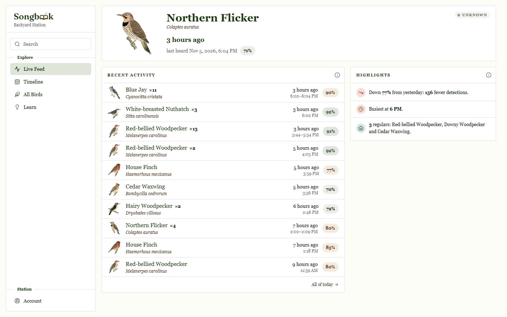

<p align="center">
  
</p>
<p align="center">
A record of every bird singing in your yard.
</p>

Songbook listens through a microphone around the clock, identifies birds with the
[BirdNET](https://github.com/kahst/BirdNET-Analyzer) model, and keeps a searchable record of them
in a web interface you host yourself. No account and no subscription. Your recordings stay on your
Pi.

<p align="center">
  
</p>

## Features

- **Live** shows what was just heard. **Timeline** shows any day, week, month or year.
- **All Birds** has a page per species: history, peak hours and its best recording.
- **Learn** quizzes you on the calls your own station recorded.
- **Review** and **Species filter** let you correct mistakes, behind a password.
- **Health** shows whether each part of the station is working, and how to fix it if not.

## Quick start

You need a Raspberry Pi 5, 4B or 3B+ running Raspberry Pi OS Lite (64-bit), and a USB microphone.
On the Pi, run:

```bash
curl -s https://raw.githubusercontent.com/CalebLovell/Songbook/main/newinstaller.sh | bash
```

It asks you to choose a password, then reboots. Open `http://songbook.local` from a
device on the same network, sign in, and check **Health**.

New to this? The [setup guide](SETUP.md) goes from a blank memory card to a listening
station, step by step.

## Documentation

- [Setup guide](SETUP.md): what to buy, preparing the card, installing, the first hour and
  troubleshooting.
- [Running a station](SETUP.md#updating): updates, backups, making a station public and
  uninstalling.
- [Development](CONTRIBUTING.md): working on the web UI, and how releases are made.

## License and credits

**Non-commercial use only.** Songbook is licensed under [CC BY-NC-SA 4.0](LICENSE), inherited from
the projects it builds on. You may not use it to develop a commercial product.

- [BirdNET](https://github.com/kahst/BirdNET-Analyzer), the model that identifies the birds, is
  by [@kahst](https://github.com/kahst) and the K. Lisa Yang Center for Conservation Bioacoustics
  at the Cornell Lab of Ornithology.
- Songbook began as a fork of [BirdNET-Pi](https://github.com/mcguirepr89/BirdNET-Pi) by
  [@mcguirepr89](https://github.com/mcguirepr89), continued by
  [@Nachtzuster](https://github.com/Nachtzuster/BirdNET-Pi).
- [YAMNet](https://github.com/tensorflow/models/tree/master/research/audioset/yamnet), the model
  behind the voice check, is by Google and licensed under Apache 2.0.
- Translated bird names are thanks to [@patlevin](https://github.com/patlevin) and Wikipedia.
