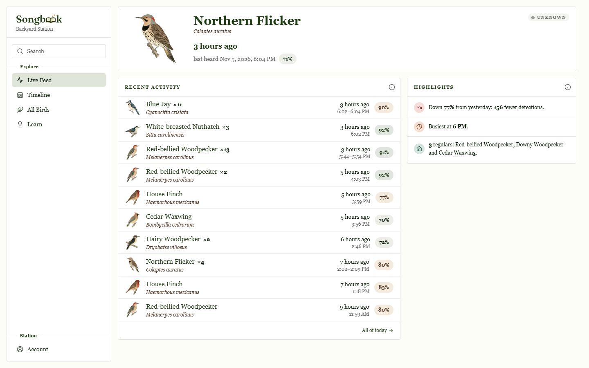
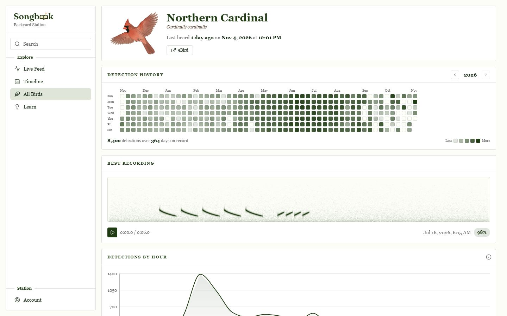
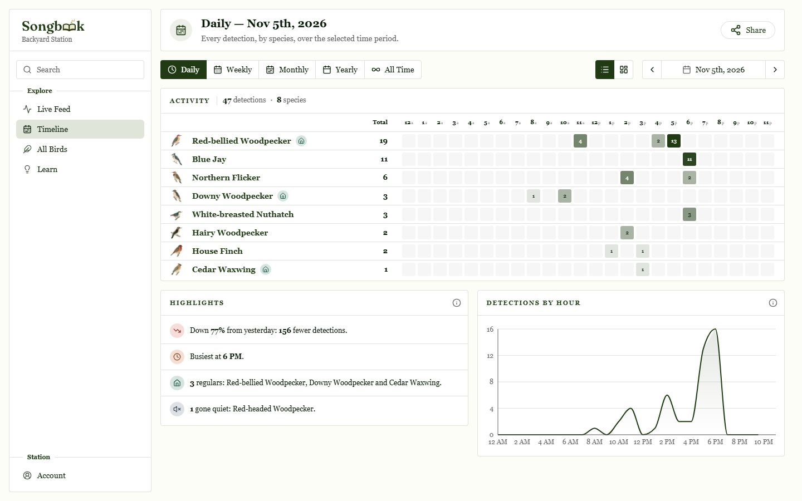
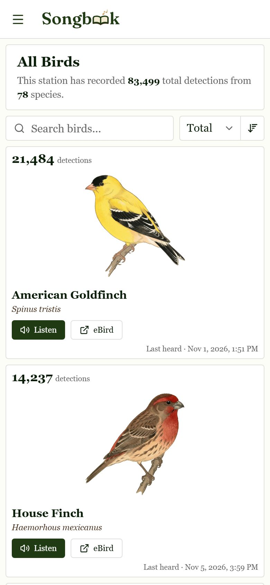

<p align="center">
  
</p>
<p align="center">
A record of every bird singing in your yard.
</p>

Songbook listens through a microphone around the clock, identifies birds with the
[BirdNET](https://github.com/kahst/BirdNET-Analyzer) model, and keeps a searchable record of
them in a web interface you host yourself. No account and no subscription. Your recordings stay
on your Pi.

<p align="center">
  
</p>

| Species | Timeline | Phone |
| --- | --- | --- |
|  |  |  |

The screenshots use generated test data, not a real station.

- **Live** shows what was just heard. **Timeline** shows any day, week, month or year.
- **All Birds** has a page per species: history, peak hours and its best recording.
- **Learn** quizzes you on the calls your own station recorded.
- **Review** and **Species filter** let you correct mistakes, behind a password.

**Non-commercial use only.** See [License and credits](#license-and-credits).

> [!WARNING]
> **Not yet proven on fresh hardware.** Nobody has run the installer below end to end on a real
> Pi from this repository yet. Setup, the first hour and troubleshooting come from reading
> `scripts/`, not from watching them run. Sections marked *(unverified)* are the ones to doubt.
> Please open an issue if something differs.

## What to buy

- **A Raspberry Pi 5 or 4B.** The [BirdNET-Pi page at Cornell](https://birdnet.cornell.edu/birdnet-pi/)
  recommends these for best performance and says a 3B+ or Zero 2 W can work on a lightweight OS.
  The installer needs a 64-bit OS, and a Pi 400 also meets that.
- **A microSD card, high-endurance, 64 GB or larger.** That size and type come from
  [this hardware guide](https://github.com/wr/featherframe/wiki/Hardware-BirdNET). Songbook keeps
  the raw recording chunks in RAM, but it still saves clips and a database to the card.
- **The official power supply**, and Ethernet if a cable can reach.
- **A USB microphone.** Start with the first one here unless you already know you want more:

| Microphone | Why | Catch |
| --- | --- | --- |
| **Boya BY-LM40** | Inexpensive and plugs straight into USB. Cornell names Boya among its preferred plug-and-play brands, alongside Saramonic. | [Less sensitive](https://github.com/wr/featherframe/wiki/Hardware-BirdNET) than the option below. |
| **Clippy EM272** (Micbooster) with a mono USB sound card | [Described as](https://github.com/wr/featherframe/wiki/Hardware-BirdNET) the most recommended in the BirdNET-Pi community, and much more sensitive. | More parts. Cornell [advises avoiding external sound cards](https://birdnet.cornell.edu/birdnet-pi/) because of ground-loop buzz, so these two sources disagree. |

We haven't tested either one with Songbook, so treat this as what others report. One
[BirdNET-Pi discussion](https://github.com/Nachtzuster/BirdNET-Pi/discussions/639) is worth reading
first: a lavalier mic on a USB adapter came out far too quiet, while a cheap capsule on a no-name
USB module logged around 30 species a day. Interface, gain and background noise can matter as much
as the mic's price.

**Placement:** outdoors, away from traffic, fans and your own voice, and sheltered from wind and
rain. Cornell suggests a weatherproof junction box or a birdhouse-style mount, with acoustic fabric
over the mic.

## Setup

*(unverified)* You need the **64-bit** Raspberry Pi OS (Trixie; Lite is recommended) and a user
with passwordless sudo, which is the Raspberry Pi OS default. Plug in the microphone, then run this
on the Pi as your normal user:

```bash
curl -s https://raw.githubusercontent.com/CalebLovell/Songbook/main/newinstaller.sh | bash
```

It installs the newest release and its dependencies, asks you to choose a password for the web UI,
and reboots. It keeps a log at `~/installation-<date>.txt`. If your Pi is still called
`raspberrypi`, it gets renamed to `birdnetpi`.

Then open `http://birdnetpi.local` from a device on the same network. Anyone who can reach the
station can view it. Settings, Review and Species filter need the password.

Next, open **Settings → Station** and check the location. The installer guesses it from your IP
address using ip-api.com, and that guess decides which species are expected at your station.

## The first hour

*(unverified)*

- The station records 15-second chunks and analyzes each one, so a bird should appear within a
  minute or so of being heard, if it passes the filters.
- Pages stay empty until the first detection. That is normal, especially at midday or at night.
  Dawn is the best first test.
- Only detections at 70% confidence or higher are kept (**Settings → Detection**). Expect some
  wrong guesses at first. Use **Review** to correct them rather than lowering the threshold right
  away.
- Most of the interesting pages (trends, regulars, Highlights) need days of data to mean much.

## Troubleshooting

*(unverified)*

**No birds after a few hours.** Check that recording and analysis are running:

```bash
journalctl -u birdnet_recording -u birdnet_analysis --since "1 hour ago"
```

Then play a clear bird call from a phone close to the mic. If it isn't detected, suspect the mic
(next items). If it is, the problem is placement or noise. Check the capture level with `alsamixer`.

**Wrong location, or the wrong kinds of birds.** A VPN or an unusual internet connection can give a
bad guess, and a failed lookup leaves the location at 0, 0. Set the real values in **Settings →
Station**. Species filtered out by a wrong location are not recoverable afterward.

**Microphone not found.** List what the Pi can see:

```bash
arecord -l
```

If the mic is missing, try another USB port or a powered hub. If it's listed but nothing records,
choose it under **Settings → Audio input → Recording device**, and check **Channels** there: the
default is 2, and a mono device may need 1.

**Can't reach `birdnetpi.local`.** Names ending in `.local` don't work on every device or network,
so use the IP address, which you can get from your router or by running `hostname -I` on the Pi. If
you named the Pi something else when flashing it, the address is `http://<that name>.local`. Your
device must be on the same network, not a guest network.

**Forgotten password, or "No password yet".** Set a new one on the Pi. There is no default password
and no reset by email.

```bash
sudo ~/BirdNET-Pi/scripts/set_web_ui_password.sh
```

## Updating

Stations update from this repository's GitHub releases. Settings → Updates shows the installed
version and the newest release, with **Check**, **Update to …** and an **Automatic updates** switch
(`AUTOMATIC_UPDATE` in `birdnet.conf`). Every night between 3 and 5 AM `birdnet_update.timer` looks
for a new release: with the switch on it installs it, with it off it only marks Settings in the
sidebar so you can press Update when you like.

```bash
update_birdnet.sh        # install the newest release now
update_birdnet.sh -c     # only check
```

An update downloads the release's prebuilt web UI beside the running one, checks it against the
sha256 in the release's `release.json`, moves the code to the release's commit, and restarts. If the
web UI doesn't answer afterwards, the station goes back to the version it had. Progress is in
`~/BirdNET-Pi-web/update-status.json` and `journalctl -u birdnet_update_now`.

## Making a station public

> [!CAUTION]
> **A public station is a public microphone. Read this first.**
> - **Visitors can play one clip per species.** Those clips are real audio from wherever your mic
>   is. Every other recording and the live stream require sign-in.
> - **Each public clip is checked for a human voice first.** A voice check runs on the species' best
>   clip. If it hears a voice, the clip stays private and the next-best clip is checked instead. A
>   clip stays private until it passes. In testing, the check caught every voice 10 dB quieter than
>   the bird, about 60% at 20 dB quieter, and few at 30 dB quieter, so a faint voice can still get
>   through. It also listens only for voices, not for other household sounds.
> - **The recording filter can miss speech too.** It drops audio when BirdNET ranks a human sound
>   among its top predictions. `PRIVACY_THRESHOLD` (**Settings → Privacy**, 0–3) widens how far down
>   the list it looks, and 0 still checks the top 10. Keep the mic away from patios, windows and
>   sidewalks.
> - **Recording laws vary by place**, especially for conversations and neighbors. Check yours
>   before putting the mic outside or the station online. This is not legal advice.
> - **Coordinates stay private.** Public pages don't include your latitude or longitude. The station
>   name is shown publicly, so don't use your address.

The web UI serves port 80 on your network. To reach it from the internet, put a tunnel or reverse
proxy that you control in front of it, then tell the web UI to trust the address that proxy
forwards. Sign-in throttling then sees real visitors, and link previews use your public address.

```bash
sudo systemctl edit birdnet_web_ui.service
```

```ini
[Service]
Environment=WEB_UI_TRUSTED_PROXY=1
```

Only set this behind a proxy running on the Pi itself, such as `cloudflared`. The
app trusts forwarded addresses only from a connection on the same machine, so
other devices on your network can't fake theirs.

## Backup and restore

```bash
./scripts/backup_data.sh -a backup -f /mnt/birds/backup.tar
./scripts/backup_data.sh -a restore -f /mnt/birds/backup.tar
```

## Uninstalling

```bash
/usr/local/bin/uninstall.sh && cd ~ && rm -drf BirdNET-Pi
```

## Development

The web UI is in [`web-ui/`](web-ui/README.md), and its design rules are in
[`web-ui/DESIGN.md`](web-ui/DESIGN.md). The recording and analysis services are in `scripts/`.

Generated images are committed, and these commands, run in `web-ui/`, rebuild them:

```bash
npm run link-images
```

```bash
npm run db:reset && npm run build && npm run screenshots
```

The first renders the link-preview image and home-screen icons. The second captures this README's
screenshots from test data, using a throwaway config so no real station name or coordinates appear.
`db:reset` replaces the local dev database.

Releases are automatic. Every push to `main` runs `.github/workflows/release.yml`, which checks the
web UI and then lets [semantic-release](https://semantic-release.gitbook.io/) read the
[Conventional Commits](https://www.conventionalcommits.org/) since the last release to pick the
version:

| Commit message | Release |
| --- | --- |
| `fix(ui): …`, `perf: …` | patch: 1.4.0 → 1.4.1 |
| `feat(ui): …` | minor: 1.4.0 → 1.5.0 |
| `feat(ui)!: …`, or a `BREAKING CHANGE:` footer | major: 1.4.0 → 2.0.0 |
| `test:`, `docs:`, `chore:`, `refactor:`, `style:`, `ci:` | none |

The highest one among the new commits wins. When there is a release, it builds the web UI bundle
(`scripts/package_release.sh`), tags the commit `vX.Y.Z`, and publishes the GitHub release with notes
grouped from the commit messages.

The checks (Biome, TypeScript, tests) run first, and a failing check means no release.
`.githooks/pre-push` runs the same checks before a push to `main`; turn it on once per clone with
`git config core.hooksPath .githooks`.

## License and credits

Songbook is licensed under [CC BY-NC-SA 4.0](LICENSE), inherited from the projects it builds
on. **You may not use it to develop a commercial product.**

- [BirdNET](https://github.com/kahst/BirdNET-Analyzer), the model that identifies the birds, is
  by [@kahst](https://github.com/kahst) and the K. Lisa Yang Center for Conservation Bioacoustics
  at the Cornell Lab of Ornithology.
- Songbook began as a fork of [BirdNET-Pi](https://github.com/mcguirepr89/BirdNET-Pi) by
  [@mcguirepr89](https://github.com/mcguirepr89), continued by
  [@Nachtzuster](https://github.com/Nachtzuster/BirdNET-Pi).
- [YAMNet](https://github.com/tensorflow/models/tree/master/research/audioset/yamnet), the model
  behind the voice check, is by Google and licensed under Apache 2.0.
- Translated bird names are thanks to [@patlevin](https://github.com/patlevin) and Wikipedia.
